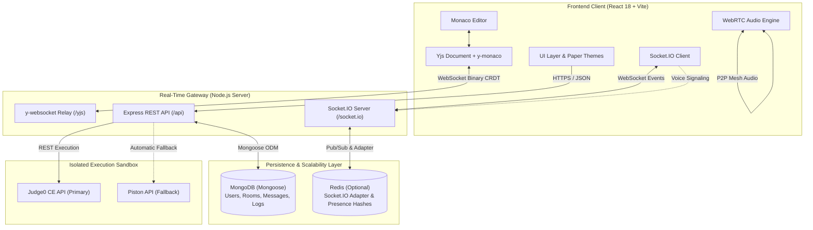

# CodeTogether — Real-Time Collaborative Code Editor & Technical Interview Studio

<div align="center">


<p align="center">
  <strong>A high-performance, full-stack collaborative IDE and technical interview platform.</strong><br>
  Built with <strong>React 18</strong>, <strong>Monaco Editor</strong>, <strong>Yjs CRDTs</strong>, <strong>WebRTC Voice</strong>, <strong>Socket.IO</strong>, <strong>Express</strong>, <strong>MongoDB</strong>, <strong>Redis</strong>, and <strong>Judge0/Piston sandboxes</strong>.
</p>

[Key Features](#-key-features) •
[System Architecture](#-system-architecture) •
[Quick Start](#-quick-start) •
[Environment Variables](#-environment-variables) •
[API Documentation](#-api-documentation) •
[WebSocket Contracts](#-websocket--webrtc-contracts) •
[Paper Design System](#-paper-design-system) •
[Testing](#-testing) •
[Deployment](#-deployment-guide)

---

</div>

## 🌟 Executive Summary

**CodeTogether** is an enterprise-grade collaborative coding environment engineered for pair programming, mock technical interviews, classroom instruction, and real-time remote debugging. Multiple scribes can seamlessly co-author code in the same workspace with conflict-free synchronization (sub-10ms CRDT merges), see live colored cursors and text selections, talk directly through peer-to-peer WebRTC voice calls, run synchronized interview timers, test code against LeetCode-style automated test suites, and execute multi-language source files inside isolated sandboxes.

The application is wrapped in an artisanal **Editorial Paper Design System** featuring **Editorial Parchment** (Light Paper) and **Midnight Kraft** (Dark Paper) themes, complete with tactile micro-textures, fountain-ink typography, sealing-wax accents, and custom Monaco syntax definitions.

---

## 🚀 Key Features

### ⚡ Conflict-Free Real-Time Collaboration
- **Yjs CRDT Synchronization**: Pure Conflict-Free Replicated Data Type document sync via a dedicated `y-websocket` binary relay. Concurrent keystrokes merge deterministically without race conditions or data loss.
- **Monaco Editor Integration**: Full-featured VS Code editing experience with syntax highlighting, IntelliSense auto-completion, line numbers, mini-map, and automatic document formatting.
- **Archival Ink Awareness**: Real-time peer cursors and selections rendered via Yjs Awareness with an 8-tone fountain ink and sealing wax palette (`Terracotta`, `Olive Sage`, `Blueprint Indigo`, `Amber Ochre`, `Mulberry Plum`, etc.).
- **Live Presence & De-Duplication**: Tracks active connections per user; automatically collapses multiple open browser tabs into unified presence badges.

### 🎨 Tactile Paper Themes (Light & Dark)
- **Editorial Parchment (Light)**: Warm ivory vellum canvas (`#F7F4EB`), crisp cotton paper sheets (`#FFFFFF`), pressed kraft panels (`#F0EADE`), pencil ruling borders (`#DDD5C7`), and walnut fountain pen ink (`#221C16`).
- **Midnight Kraft (Dark)**: Matte charcoal paper canvas (`#181715`), dark cardstock sheets (`#201F1B`), elevated pressed kraft cards (`#2A2822`), fiber crease borders (`#383630`), and bone-white gel ink (`#ECE7DC`).
- **Tactile Paper Details**: Micro-fiber paper grain overlay, warm ambient shadows (`shadow-paper`), sealing-wax badges, and custom matching Monaco themes (`paper-parchment` & `paper-midnight-kraft`).
- **Persistent Theme Toggle**: Seamless header switch toggling between Parchment and Midnight Kraft with instant reactive Monaco re-theming.

### 🎙️ In-Room WebRTC Peer-to-Peer Voice Calling
- **Zero Third-Party Audio Services**: High-fidelity, low-latency audio communication powered by native WebRTC `RTCPeerConnection` and STUN relays (`stun.l.google.com:19302`).
- **Mesh Voice Topology**: Directly negotiates offers/answers and ICE candidates over Socket.IO without audio routing through the backend server.
- **In-Room Voice Controls**: Live participant counter, active speaker indicators, microphone mute/unmute, and clean graceful disconnects.

### ⏱️ Technical Interview Mode & Test Suite Runner
- **Synchronized Interview Stopwatch**: Host-controlled interview timer synchronized across all participants via Socket.IO. Includes presets for 30 min, 45 min, 60 min, and freeform stopwatch counting.
- **LeetCode-Style Test Case Runner**: Interactive test suite allowing candidates and interviewers to define multiple inputs (stdin), run all test cases simultaneously, and inspect actual vs. expected output diffs.

### 🗂️ Multi-File Workspace & Instant ZIP Export
- **Multi-File Project Tabs**: Create, rename, delete, and switch between multiple files with active tab indicators and dirty state detection.
- **Stationery File Explorer**: Collapsible table-of-contents file tree with colored extension stamps (`JS`, `TS`, `PY`, `C++`, `GO`, `RS`, `JV`, `JSON`).
- **One-Click Project ZIP Export**: Client-side ZIP packaging that bundles all project files into a downloadable archive.

### ⚙️ Multi-Language Execution with Dual Sandbox Engines
- **15+ Programming Languages**: Instant execution for JavaScript, TypeScript, Python, C, C++, Java, Go, Rust, PHP, Ruby, Kotlin, Swift, C#, Dart, and SQL.
- **Primary Sandbox (Judge0 CE)**: Secure remote execution via Judge0 with CPU, memory, and wall-time limits.
- **Automated Fallback (Piston Sandbox)**: Transparent, automatic fallback to the Piston execution engine if the primary sandbox is unavailable, ensuring high availability.
- **Interactive Stdin Console**: Typewriter-style console supporting standard input (interactive scripts, competitive programming prompts), compiler diagnostic errors, stdout, and stderr.

### 🚀 Instant 1-Click Guest Playground
- **Zero Registration Barrier**: Jump directly into a collaborative session from the landing page with a single click.
- **Scoped Guest Tokens**: Automatically generates signed guest JWTs with restricted, time-limited room permissions stored in session storage.

### 🔐 Enterprise-Grade Security
- **JWT Authentication with Refresh Token Rotation**: 15-minute access tokens and 30-day rotating refresh tokens. Reusing an old refresh token immediately revokes the entire session chain (theft detection).
- **Zod Schema Validation**: Strict payload inspection on all REST routes and WebSocket events, including automated protection against directory traversal attacks (`..` or absolute paths).
- **Role-Based Access Control (RBAC)**: Distinct permissions for `HOST`, `EDITOR`, `VIEWER`, and `GUEST`. Host operations (locking, kicking, role changes) are re-verified against the database on both REST and WebSocket layers.
- **Rate Limiting & Hardening**: Strict rate limiting on authentication and code execution endpoints, Helmet headers, locked CORS origins, and SHA-256 token hashing.

### 🌐 Horizontal Scalability
- **Redis Presence & Socket.IO Adapter**: Connect multiple server instances behind a load balancer with `@socket.io/redis-adapter` and Redis Hash presence storage (`presence:<roomId>`).
- **Graceful Fallback**: Automatically falls back to high-performance in-memory presence and single-node event routing when `REDIS_URL` is omitted.

### 🛡️ Archival Administration Console
- **System Metrics**: Real-time stats across registered users, active rooms, code executions, and platform health.
- **User Governance**: Suspend, unsuspend, and remove offending accounts.
- **Room Moderation**: Remotely lock, unlock, or delete abusive rooms.
- **Audit Logging**: Structured activity logs tracking critical administrative actions.

---

## 🏗️ System Architecture

CodeTogether uses an intentional **dual-channel real-time architecture**: high-volume CRDT document operations are isolated on a dedicated WebSocket relay, while room state, presence, voice signaling, and chat are orchestrated over Socket.IO.



### Why Separate `/yjs` and `/socket.io`?
1. **CRDT Isolation**: Yjs synchronization uses raw binary message encoding (`lib0`) designed for sub-millisecond document sync. Keeping it on a dedicated WebSocket endpoint prevents heavy text editing deltas from queuing behind JSON chat messages or presence heartbeats.
2. **Room Boundary Security**: Each document channel is isolated by `roomId:fileName`, preventing data leakage across different rooms or tabs.
3. **Independent Scalability**: Real-time document sync and state orchestration can be load-balanced and scaled independently.

---

## 📁 Repository Structure

```
collaborative-code-editor/
├── client/                          # React + Vite Frontend
│   ├── public/                      # Static assets & favicon
│   ├── src/
│   │   ├── components/
│   │   │   ├── chat/                # Marginalia Chat panel
│   │   │   ├── common/              # Navbar, ThemeToggle, ErrorBoundary, PageLoading
│   │   │   ├── editor/              # CollabEditor, FileTabs, FileExplorer, OutputConsole
│   │   │   └── room/                # VoiceRoom, InterviewTimer, Modals (Share, File, Leave)
│   │   ├── config/                  # Monaco theme definitions (parchment & midnight kraft)
│   │   ├── constants/               # Language definitions, file badges, extensions
│   │   ├── hooks/                   # useRoomSocket and connection lifecycle hooks
│   │   ├── pages/                   # Landing, Login, Register, Dashboard, Room, Profile, Admin
│   │   ├── services/                # api.js (Axios instance), socket.js (Socket.IO client)
│   │   ├── store/                   # authStore.js, themeStore.js (Zustand)
│   │   ├── utils/                   # clipboard.js, color.js (archival palette), zip.js
│   │   ├── index.css                # Tailwind base + Paper theme tokens & textures
│   │   └── main.jsx                 # Client entry point
│   ├── index.html                   # HTML document template
│   ├── tailwind.config.js           # Tailwind theme extensions (paper shadows, colors, fonts)
│   └── vite.config.js               # Vite build configuration
│
├── server/                          # Express + Node.js Backend
│   ├── scripts/                     # Database migration & maintenance scripts
│   ├── src/
│   │   ├── config/                  # MongoDB database connection
│   │   ├── constants/               # Supported languages & Judge0/Piston mapping
│   │   ├── controllers/             # authController, roomController, adminController
│   │   ├── middleware/              # auth, admin, roomAccess, rateLimiter, validateRequest
│   │   ├── models/                  # User, Room, Message, Execution, ActivityLog
│   │   ├── routes/                  # authRoutes, roomRoutes, adminRoutes
│   │   ├── services/                # authService, roomService, executionService
│   │   ├── sockets/                 # index.js (Socket.IO events), yjsServer.js (y-websocket)
│   │   ├── utils/                   # jwt.js, guestToken.js, logger.js, presenceStore.js
│   │   ├── validators/              # Zod validation schemas
│   │   └── server.js                # Server entry point & graceful shutdown hooks
│   └── tests/                       # 79 automated test suites (node --test)
│
├── scripts/                         # Root helper scripts (concurrent dev runner)
├── render.yaml                      # Render Infrastructure Blueprint (Server + Client)
├── package.json                     # Root orchestrator package
└── README.md                        # Project documentation
```

---

## 💻 Tech Stack

| Domain | Technology | Description |
|---|---|---|
| **Frontend Framework** | React 18 & Vite 5 | Modern component architecture with lightning-fast HMR |
| **Styling & Design** | Tailwind CSS 3 | Bespoke paper design tokens, warm tactile shadows, custom scrollbars |
| **Code Editor** | Monaco Editor (`@monaco-editor/react`) | VS Code editor core with dual paper themes |
| **CRDT Synchronization**| Yjs, `y-monaco`, `y-websocket` | State-of-the-art conflict-free concurrent editing |
| **Real-Time Messaging** | Socket.IO 4 | WebSocket transport for chat, presence, timer, and permissions |
| **Audio Communication** | WebRTC (`RTCPeerConnection`) | Peer-to-peer browser mesh voice calling with STUN |
| **State Management** | Zustand | Lightweight, reactive auth and theme state stores |
| **Backend Runtime** | Node.js (>=18) & Express 4 | Robust REST API server and WebSocket upgrade handler |
| **Database** | MongoDB & Mongoose 8 | Document storage with TTL indexes for token auto-expiry |
| **Cache & Scaling** | Redis 4 & `@socket.io/redis-adapter` | Distributed room presence hashes and cross-node broadcasting |
| **Code Execution** | Judge0 CE & Piston Sandboxes | Isolated remote compilation & execution with automatic fallback |
| **Security & Auth** | JWT, bcrypt, Zod, Helmet | Token rotation, input validation, rate limiting, and RBAC |
| **Testing** | Node.js Test Runner (`node --test`) | Native, zero-dependency unit and integration test suite |

---

## ⚡ Quick Start

### 1. Prerequisites
- **Node.js**: `v18.0.0` or higher
- **npm**: `v9.0.0` or higher
- **MongoDB**: Local MongoDB instance (`mongodb://localhost:27017/collab-editor`) or a free [MongoDB Atlas](https://www.mongodb.com/cloud/atlas) cluster
- **(Optional) Redis**: Local Redis server or cloud Redis (Upstash) for multi-node testing

### 2. Clone the Repository
```bash
git clone https://github.com/your-username/collaborative-code-editor.git
cd collaborative-code-editor
```

### 3. Install Dependencies
Install dependencies for both frontend and backend packages:
```bash
# Install backend dependencies
cd server
npm install

# Install frontend dependencies
cd ../client
npm install

# Return to root
cd ..
```

### 4. Configure Environment Files
Create `.env` files from the provided templates:

```bash
cp server/.env.example server/.env
cp client/.env.example client/.env
```

### 5. Start the Development Servers
From the root directory, start both client and server concurrently:
```bash
npm run dev
```

- **Frontend**: [http://localhost:5173](http://localhost:5173)
- **Backend API**: [http://localhost:5000/api](http://localhost:5000/api)
- **WebSocket Gateway**: `http://localhost:5000` (`/socket.io` and `/yjs`)

---

## ⚙️ Environment Variables

### Backend (`server/.env`)

| Variable | Required | Default | Description |
|---|---|---|---|
| `PORT` | No | `5000` | HTTP port the Express server listens on |
| `NODE_ENV` | No | `development` | Runtime environment (`development` or `production`) |
| `MONGO_URI` | **Yes** | `mongodb://localhost:27017/collab-editor` | MongoDB connection URI |
| `JWT_SECRET` | **Yes** | — | Secret string (minimum 32 characters) for signing JWT tokens |
| `JWT_EXPIRES_IN` | No | `15m` | Access token expiration duration |
| `REFRESH_TOKEN_DAYS`| No | `30` | Refresh token lifespan in days |
| `GUEST_TOKEN_TTL_HOURS` | No | `24` | Guest session token duration in hours |
| `MAX_GUESTS_PER_ROOM` | No | `50` | Maximum concurrent active guests permitted per room |
| `CLIENT_URL` | **Yes** | `http://localhost:5173` | Allowed frontend origin for CORS and cookies |
| `JUDGE0_API_URL` | No | `https://ce.judge0.com` | Judge0 execution API endpoint |
| `JUDGE0_API_KEY` | No | `""` | Judge0 API key (blank for official free CE instance) |
| `JUDGE0_API_HOST` | No | `ce.judge0.com` | Judge0 host header |
| `REDIS_URL` | No | `""` | Redis connection URL for multi-instance scaling |

### Frontend (`client/.env`)

| Variable | Required | Default | Description |
|---|---|---|---|
| `VITE_API_URL` | **Yes** | `http://localhost:5000/api` | Base URL for backend REST API endpoints |
| `VITE_SOCKET_URL` | **Yes** | `http://localhost:5000` | Base URL for Socket.IO connection |
| `VITE_YJS_URL` | **Yes** | `ws://localhost:5000/yjs` | WebSocket URL for Yjs CRDT relay (`wss://` in prod) |

---

## 📖 API Documentation

All REST routes are prefixed with `/api`. Protected routes require an `Authorization: Bearer <token>` header or a valid session cookie.

### 🩺 Health & Diagnostics
| Method | Endpoint | Access | Description |
|---|---|---|---|
| `GET` | `/health` | Public | Returns database connection status, server uptime, and timestamp |

### 🔐 Authentication (`/api/auth`)
| Method | Endpoint | Access | Description |
|---|---|---|---|
| `POST` | `/register` | Public (Rate Limited) | Creates a new user account with hashed credentials |
| `POST` | `/login` | Public (Rate Limited) | Authenticates user; returns access token and sets refresh cookie |
| `POST` | `/refresh` | Public | Rotates refresh token and returns a fresh access token |
| `POST` | `/logout` | Authenticated | Revokes the current refresh token chain and clears cookies |
| `GET` | `/me` | Authenticated | Retrieves current user profile and permission details |
| `PATCH` | `/me` | Authenticated | Updates full name and avatar URL |
| `PATCH` | `/me/password` | Authenticated | Updates user password with validation check |

### 🏠 Rooms & Playground (`/api/rooms`)
| Method | Endpoint | Access | Description |
|---|---|---|---|
| `POST` | `/instant` | Public / Optional Auth | Spawns an immediate 1-click playground and guest token |
| `POST` | `/` | Authenticated | Creates a permanent collaborative room |
| `GET` | `/` | Authenticated | Lists all rooms owned, joined, or starred by the user |
| `GET` | `/:roomId` | Member / Guest | Retrieves room metadata, settings, and file list |
| `PATCH` | `/:roomId` | Room Host | Updates room name, description, settings, or lock status |
| `DELETE` | `/:roomId` | Room Host | Permanently archives and deletes the room |
| `POST` | `/:roomId/join` | Member / Guest | Enrolls user or guest into the room session |
| `POST` | `/:roomId/leave`| Member / Guest | Exits the active room session |
| `POST` | `/:roomId/star` | Authenticated | Toggles star / bookmark status for the room |
| `GET` | `/:roomId/messages` | Member / Guest | Cursor-paginated chat history (`?limit=50&before=<id>`) |

### 🗂️ File Management (`/api/rooms/:roomId/files`)
| Method | Endpoint | Access | Description |
|---|---|---|---|
| `GET` | `/` | Member / Guest | Lists all files and languages in the room |
| `POST` | `/` | Host / Editor | Creates a new file (validates against path traversal) |
| `PUT` | `/:fileName` | Host / Editor | Persists file buffer / content changes |
| `PATCH` | `/:fileName` | Host / Editor | Renames an existing file and updates language binding |
| `DELETE` | `/:fileName` | Host / Editor | Deletes a file from the room |

### ⚙️ Code Execution (`/api/rooms/:roomId/execute`)
| Method | Endpoint | Access | Description |
|---|---|---|---|
| `POST` | `/` | Host / Editor (Rate Limited) | Executes source code in sandbox with stdin support |

### 👥 Member Governance (`/api/rooms/:roomId/members`)
| Method | Endpoint | Access | Description |
|---|---|---|---|
| `PATCH` | `/permission` | Room Host | Promotes or demotes member (`EDITOR` or `VIEWER`) |
| `DELETE` | `/:username` | Room Host | Removes / kicks a member from the room |

### 🛡️ Administration Console (`/api/admin`)
*Requires authenticated user with `ADMIN` role.*
| Method | Endpoint | Description |
|---|---|---|
| `GET` | `/stats` | Platform metrics (total users, rooms, executions, active scribes) |
| `GET` | `/users` | Paginated user registry with account statuses |
| `PATCH` | `/users/:userId/suspend` | Suspends an account, terminating active sessions |
| `PATCH` | `/users/:userId/unsuspend` | Restores account privileges |
| `DELETE` | `/users/:userId` | Permanently deletes a user record |
| `GET` | `/rooms` | List of all platform rooms with membership counts |
| `PATCH` | `/rooms/:roomId/lock` | Globally locks room against guest/member entry |
| `PATCH` | `/rooms/:roomId/unlock` | Unlocks room for authorized scribes |
| `DELETE` | `/rooms/:roomId` | Permanently deletes an abusive or orphaned room |
| `GET` | `/activity-logs` | Auditing log stream for security compliance |

---

## 📡 WebSocket & WebRTC Contracts

### 1. Socket.IO Events (Namespace: `/`)

#### Client to Server
```typescript
// Join & Presence
socket.emit("join-room", { roomId: string, guestToken?: string });
socket.emit("leave-room", { roomId: string });
socket.emit("heartbeat", { roomId: string });
socket.emit("presence-idle", { roomId: string, idle: boolean });

// Marginalia Chat
socket.emit("chat-message", { roomId: string, text: string });

// Interview Mode & Timer
socket.emit("timer-sync", { roomId: string, seconds: number, isRunning: boolean });

// File Tree Operations
socket.emit("file-created", { roomId: string, file: { name: string, language: string } });
socket.emit("file-renamed", { roomId: string, oldName: string, newName: string });
socket.emit("file-deleted", { roomId: string, fileName: string });
socket.emit("file-language-change", { roomId: string, fileName: string, language: string });

// Execution Broadcasts
socket.emit("execution-started", { roomId: string, language: string });

// WebRTC Voice Signaling
socket.emit("voice-join", { roomId: string });
socket.emit("voice-signal", { roomId: string, targetSocketId: string, signal: RTCSessionDescriptionInit | RTCIceCandidateInit });
socket.emit("voice-mute", { roomId: string, isMuted: boolean });
socket.emit("voice-leave", { roomId: string });
```

#### Server to Client Broadcasts
```typescript
socket.on("room-joined", (data: { room: RoomObject, role: string, user: UserSummary }) => void);
socket.on("presence-update", (participants: Array<{ username: string, status: string, connections: number }>) => void);
socket.on("chat-message", (message: { _id: string, username: string, text: string, createdAt: string }) => void);
socket.on("timer-synced", (data: { seconds: number, isRunning: boolean }) => void);
socket.on("file-created", (file: { name: string, language: string }) => void);
socket.on("file-renamed", (data: { oldName: string, newName: string }) => void);
socket.on("file-deleted", (data: { fileName: string }) => void);
socket.on("file-language-changed", (data: { fileName: string, language: string }) => void);
socket.on("execution-started", (data: { username: string, language: string }) => void);
socket.on("execution-completed", (result: ExecutionResultObject) => void);
socket.on("permission-changed", (data: { username: string, role: string }) => void);
socket.on("room-locked", (data: { locked: boolean }) => void);
socket.on("user-joined-voice", (data: { socketId: string, username: string }) => void);
socket.on("user-left-voice", (data: { socketId: string }) => void);
socket.on("voice-signal", (data: { sourceSocketId: string, signal: any }) => void);
socket.on("error-event", (error: { message: string }) => void);
```

### 2. Yjs Document Synchronization Protocol (`/yjs`)
Connect via `WebsocketProvider` from `y-websocket`:
```javascript
import * as Y from "yjs";
import { WebsocketProvider } from "y-websocket";

const ydoc = new Y.Doc();
const provider = new WebsocketProvider(
  process.env.VITE_YJS_URL, // e.g. "ws://localhost:5000/yjs"
  `${roomId}:${fileName}`,   // Room document namespace
  ydoc,
  { params: { token: authToken } }
);

// Bind to Monaco Editor model
const ytext = ydoc.getText("monaco");
new MonacoBinding(ytext, editor.getModel(), new Set([editor]), provider.awareness);
```

---

## 🎨 Paper Design System

CodeTogether implements a tactile **Editorial Paper Design System** inspired by classical print, fine stationery, and mechanical desk instruments.

```
┌────────────────────────────────────────────────────────────────────────┐
│                        EDITORIAL PARCHMENT (LIGHT)                     │
├─────────────────┬──────────────────────────────────────────────────────┤
│ Canvas          │ Warm Ivory Vellum (#F7F4EB)                          │
│ Paper Sheets    │ Crisp Cotton Paper Sheet (#FFFFFF)                   │
│ Pressed Board   │ Inset Kraft Board (#F0EADE)                          │
│ Sealing Wax     │ Terracotta Red-Orange (#C2542D)                      │
│ Postal Stamp    │ Forest Olive Sage (#3C6E47)                          │
│ Primary Ink     │ Walnut Fountain Pen Ink (#221C16)                    │
│ Annotations     │ Graphite Pencil (#73685C)                            │
└─────────────────┴──────────────────────────────────────────────────────┘
┌────────────────────────────────────────────────────────────────────────┐
│                         MIDNIGHT KRAFT (DARK)                          │
├─────────────────┬──────────────────────────────────────────────────────┤
│ Canvas          │ Matte Charcoal Paper (#181715)                       │
│ Cardstock       │ Deep Dark Cardstock (#201F1B)                        │
│ Pressed Board   │ Elevated Pressed Kraft (#2A2822)                     │
│ Sealing Wax     │ Amber Copper Seal (#E08338)                          │
│ Patina Stamp    │ Dried Patina Sage (#5B9B74)                          │
│ Primary Ink     │ Bone-White Gel Ink (#ECE7DC)                         │
│ Dust Ash        │ Warm Ash Dust (#969082)                              │
└─────────────────┴──────────────────────────────────────────────────────┘
```

- **Micro-Texture**: An ultra-subtle fractal noise SVG overlay simulates the fibrous tooth of cotton paper.
- **Ambient Occlusion**: `shadow-paper` classes cast warm, diffuse light rather than harsh digital drop shadows.
- **Physical Tabs**: File tabs replicate index notebook dividers with a top wax ruling connecting seamlessly to the active paper editor sheet.

---

## 🧪 Testing

The backend includes a comprehensive test suite executed through Node's native test runner (`node --test`), requiring zero external dependencies.

```bash
cd server
npm test
```

### Test Coverage Highlights (79 Passing Tests across 22 Suites)
- **Security & Path Traversal (`roomValidators.test.js` & `securityHardening.test.js`)**: Verifies that relative paths (`../`), absolute paths (`/etc/passwd`), null bytes, and traversal segments are rejected.
- **Token Cryptography (`jwt.test.js` & `guestAuth.test.js`)**: Validates secret strength checks, sign/verify cycles, tamper resistance, and cross-room forgery defense.
- **Role Model & Truth Tables (`roles.test.js`)**: Exhaustive truth tables confirming permissions for `HOST`, `EDITOR`, `VIEWER`, and `GUEST`.
- **Chat Pagination & Ordering (`chatHistory.test.js`)**: Validates cursor pagination (`?limit=50&before=<id>`) and message bounds.
- **Presence De-duplication (`presence.test.js`)**: Merges multi-tab connections and purges stale records (>60s).
- **Execution Fallback (`executionService.test.js`)**: Tests primary sandbox parsing and verified fallback to Piston upon error response.
- **Lifecycle & Graceful Shutdown (`lifecycle.test.js`)**: Confirms ordered resource teardown (HTTP servers, socket connections, Redis pools, MongoDB handles).

---

## 🚀 Deployment Guide

### Deploying to Render via Blueprint (`render.yaml`)

This repository includes a `render.yaml` specification that provisions both frontend and backend automatically:

1. Push this repository to your GitHub or GitLab account.
2. In the [Render Dashboard](https://dashboard.render.com), click **New +** → **Blueprint**.
3. Select your repository. Render parses `render.yaml` and sets up:
   - **`collab-editor-server`**: Node.js Web Service running `server/`.
   - **`collab-editor-client`**: Static Site hosting `client/dist` with SPA redirect rules (`/* → /index.html`).
4. Fill in the environment variables marked `sync: false`:
   - `MONGO_URI`: Your MongoDB Atlas connection string.
   - `CLIENT_URL`: `https://<your-client-subdomain>.onrender.com`
   - `VITE_API_URL`: `https://<your-server-subdomain>.onrender.com/api`
   - `VITE_SOCKET_URL`: `https://<your-server-subdomain>.onrender.com`
   - `VITE_YJS_URL`: `wss://<your-server-subdomain>.onrender.com/yjs` *(Render terminates SSL; use `wss://`)*
5. Trigger a build. Both services will be live with TLS automatically provisioned.

---

## 🔒 Security Best Practices

- **Zero Arbitrary Execution**: User code is never executed directly on the application server. All runs are executed in isolated, sandboxed containers with strict CPU, memory, and timeout limits.
- **Token Rotation & Replay Revocation**: Refresh tokens are single-use SHA-256 hashes. If an attacker attempts to replay a rotated token, all active tokens for that user session are immediately invalidated.
- **Defense in Depth**: Access control is enforced at the database, REST middleware, and WebSocket event handler layers. Hiding a button on the client is never the sole protection.
- **Redacted Logging**: Password fields, JWT secrets, and bearer tokens are automatically stripped before reaching log files.

---

## 📄 License

This project is open-source and licensed under the [MIT License](LICENSE).

---

<div align="center">
  <sub>Crafted with precision in Editorial Parchment & Midnight Kraft.</sub>
</div>
