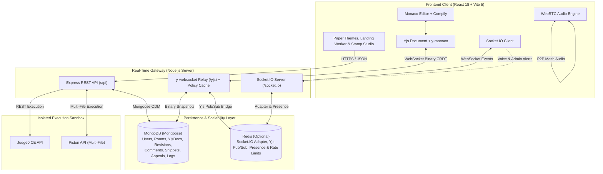

# CodeTogether — Real-Time Collaborative Code Editor & Technical Interview Studio

<div align="center">


<p align="center">
  <strong>A production-hardened collaborative IDE, Compily personal compiler, system-design studio, and technical interview platform.</strong><br>
  Built with <strong>React 18</strong>, <strong>Monaco Editor</strong>, <strong>Framer Motion</strong>, <strong>Yjs CRDTs</strong>, <strong>WebRTC Voice</strong>, <strong>Socket.IO</strong>, <strong>Express</strong>, <strong>MongoDB</strong>, <strong>Redis</strong>, and <strong>Judge0/Piston sandboxes</strong>.
</p>

[Key Features](#-key-features) •
[System Architecture](#-system-architecture) •
[Quick Start](#-quick-start) •
[Environment Variables](#-environment-variables) •
[API Documentation](#-api-documentation) •
[WebSocket Contracts](#-websocket--webrtc-contracts) •
[Testing](#-testing--ci) •
[Deployment](#-deployment-guide-renderyaml)

</div>

---

## 🌟 Executive Summary

**CodeTogether** is a full-stack collaborative coding and technical interview studio engineered for pair programming, live interviews, system-design rounds, classroom instruction, remote code reviews, and solo practice. Participants co-author multi-file projects with binary CRDT synchronization, follow teammates across files, sketch architecture on a structured whiteboard, leave line-anchored review comments, talk over peer-to-peer WebRTC voice calls, run batch tests (including hidden host-only grading cases), scrub post-interview timelines, preview HTML/CSS/JS live, share public **Compily** snippets, and evaluate candidates via private host-only scorecards.

The UI uses an artisanal **Editorial Paper Design System** featuring **Editorial Parchment** (Light Paper) and **Midnight Kraft** (Dark Paper) themes with matching custom Monaco syntax themes, an interactive scroll-through landing studio with an isolated Web Worker JS preview, and a custom **Developer Stamp Studio** for user avatars.

---

## 🚀 Key Features

### ⚡ Conflict-Free Real-Time Collaboration & Follow Mode
- **Yjs Binary CRDT Sync & Persistence**: Dedicated `y-websocket` relay (`/yjs`) backed by binary `YjsDoc` snapshots and `Room.files` text sync in MongoDB, plus optional Redis Pub/Sub synchronization across multiple server instances.
- **Monaco Editor & Read-Only Enforcement**: VS Code editing experience with live colored peer cursors (Yjs Awareness), cursor-line tracking, document formatting, `Cmd/Ctrl+K` Command Palette, and live `readOnly` enforcement for `VIEWER` / disallowed `GUEST` roles.
- **Follow Mode (Spotlight) & Presence De-Duplication**: Click **Follow** on any participant to track their active file tab changes in real time, with unified presence badges collapsing multiple open tabs per user.

### 🗂️ Nested Explorer, Templates, Question Bank, Checkpoints & Live Preview
- **Collapsible Folder Tree & Drag-and-Drop Uploads**: Supports nested paths (e.g. `utils/helpers.js`), multi-file uploads, and drag-and-drop onto the explorer.
- **Starter Templates & Interview Question Bank**: Create rooms from `Blank`, `Algorithms`, `Web Preview (HTML / CSS / JS)`, or `Multi-File Node.js`, or load curated prompts from `QUESTION_BANK` (*Two Sum*, *Valid Parentheses*, *Merge Intervals*, *LRU Cache*, *Sliding Window Rate Limiter*) complete with `prompt.md` and public + hidden grading tests.
- **Version History, Live Restore & Session Replay**: Save named file checkpoints (`DocRevision`), restore any revision live into every participant's Yjs editor, or scrub chronologically through checkpoints, code executions, and chat notes via the **Session Timeline & Replay** modal (`/timeline`).
- **Sandboxed Live Web Preview & ZIP Export**: Render room HTML, CSS, and JS inside an isolated `<iframe sandbox="allow-scripts">` and bundle entire projects via client-side ZIP export.

### 🎨 Structured Whiteboard & Line-Anchored Code Comments
- **System-Design Canvas (`Code ↔ Board`)**: Sketch diagrams in real time using **Pen, Line, Rectangle, Circle, Arrow, Text Label, and Eraser** tools, synced **Undo/Redo** (`whiteboard-undo` / `Cmd/Ctrl+Z`), Light/Dark paper canvas contrast toggle, and PNG export.
- **Line-Anchored Review Comments**: Post comments bound to specific files and line numbers (`CodeComment`), click to jump to lines in Monaco, resolve/reopen threads, and delete comments.

### ⏱️ Technical Interview Suite & Private Host Scorecard
- **Authoritative Interview Timer**: Host-only controls for countdown presets (30m / 45m / 60m) and stopwatch mode, persisted server-side (`timerState`) so late joiners stay synchronized.
- **Public & Hidden Batch Test Runner**: Synced test cases (`PUT /api/rooms/:roomId/test-cases`) executed in one batch (`POST /api/rooms/:roomId/execute-batch`). Host-marked `isHidden` test cases keep their inputs and expected outputs stripped from candidates while grading accurately on the server.
- **Private Host-Only Scorecard**: Grade Problem Solving, Code Quality, Communication (1–5), hiring recommendation, and private notes—protected at the database layer (`select: false` on `Room.scorecard`) and restricted strictly to the room owner with `.md` export.

### 💻 Compily Personal IDE & Public Shareable Snippets (`/compily`, `/s/:slug`)
- **Solo Multi-Language Compiler**: Dedicated `/compily` studio supporting all 15+ languages with starter templates, custom `stdin`, 15-case batch grading, split right/bottom layout, saved snippet library, and run history.
- **Public Share Links & Forking**: Toggle any saved snippet public to generate a `/s/:slug` link (`GET /api/compily/public/:slug`) with read-only syntax highlighting, one-click code copy, and **Fork to Compily** (`POST /api/compily/public/:slug/fork`).

### ⚙️ Multi-File Execution & 15+ Languages
- **15+ Languages**: JavaScript, TypeScript, Python, C, C++, Java, Go, Rust, PHP, Ruby, Kotlin, Swift, C#, Dart, and SQL.
- **Multi-File Execution Bundle**: Passes all room files alongside the active entrypoint to Piston (supporting relative imports across files) with Judge0 CE support and an opt-in local dev `worker_threads` JS fallback (`ALLOW_UNSAFE_LOCAL_EXEC=true`, disabled in production).

### 🎙️ WebRTC Voice, Marginalia Chat & Developer Stamp Studio
- **Peer-to-Peer Mesh Audio**: Native WebRTC `RTCPeerConnection` with backend-served STUN/TURN ICE configuration (`/api/rooms/ice-servers`), glare tie-breaking, mute/unmute state broadcast, and clean audio teardown.
- **Paginated Marginalia Chat & Developer Stamps**: Cursor-paginated history (`Load older messages`), host chat-mute enforcement, and custom **Developer Stamp** SVG glyphs (`Cipher Grid`, `Monogram`, `Code Tag`, `Lambda`, `Shell`, `Braces`, `Quill Nib`, `Compass`) rendered across Profile, Navbar, Participants, and Chat without external image URLs.

### 🔐 Security, Moderation Appeals & Governance (`/admin/*`)
- **Strict Private Rooms & Invite Secrets**: `PRIVATE` rooms reject non-members across REST, Socket.IO, and Yjs WebSockets unless invited directly or joining with a timing-safe `inviteCode` (`?invite=...`). Hosts can rotate invite secrets anytime.
- **Full Auth Lifecycle**: Registration, login, rotating SHA-256 refresh tokens with theft/reuse revocation, active session viewer & per-device revocation (`/api/auth/sessions`), `logout-all`, email verification, password reset (`/forgot-password`, `/reset-password`), and password-confirmed self-deletion (`DELETE /api/auth/me`).
- **Moderation Popups, Timed Suspensions & Appeals**: Suspended or banned users receive a structured moderation modal (`ModerationModal`) at sign-in, on `403` API rejection, or immediately via Socket.IO (`account-moderated`) where they can submit an unban appeal (`POST /api/auth/appeal`, subject to 24h post-rejection cooldown). Timed suspensions (`suspendedUntil`) auto-restore on expiration, and appeal decisions dispatch transactional emails.
- **Archival Administration Console (`/admin/*`)**:
  - **Overview (`/admin`)**: Platform KPIs (including `pendingAppeals`) + live runtime telemetry (`/api/metrics`).
  - **Users (`/admin/users`)**: Search/filter by status, suspend with optional duration (`24h`, `7d`, `30d`, `Indefinite`) and reason, ban/unban, delete accounts, and jump to pending user appeals.
  - **Appeals (`/admin/appeals`)**: Live-updating review queue (via `admin:new-appeal` Socket.IO push + tab/banner alert counts) to approve/restore or decline user appeals with optional reviewer notes.
  - **Rooms (`/admin/rooms`)** & **Activity Logs (`/admin/logs`)**: Moderate rooms, inspect audit events, and prune logs.

---

## 🏗️ System Architecture



---

## 📁 Repository Structure

```
collaborative-code-editor/
├── .github/workflows/ci.yml         # GitHub Actions CI (server tests + client build)
├── .prettierrc                      # Shared formatting rules
├── client/                          # React 18 + Vite 5 Frontend
│   ├── src/
│   │   ├── components/
│   │   │   ├── auth/                # AuthLayout
│   │   │   ├── chat/                # ChatPanel (pagination, stamps, mute state)
│   │   │   ├── common/              # Navbar, UserAvatar, ModerationModal, ConfirmModal, ThemeToggle, Guards
│   │   │   ├── dashboard/           # CreateRoomModal (templates + Question Bank), RoomCard, DeleteRoomModal
│   │   │   ├── editor/              # CollabEditor, FileTabs, FileExplorer, OutputConsole (hidden tests + preview)
│   │   │   ├── landing/             # HeroStudioPreview (Web Worker), ScrollWalkthrough, MotionPrimitives
│   │   │   └── room/                # VoiceRoom, InterviewTimer, WhiteboardPanel, CommentsPanel,
│   │   │                            # RevisionsModal, ReplayModal, ScorecardModal, HostSettingsModal, ParticipantsPanel
│   │   ├── config/                  # Monaco paper themes
│   │   ├── constants/               # Languages, Compily templates, Question Bank
│   │   ├── hooks/                   # useRoomSocket
│   │   ├── pages/
│   │   │   ├── admin/               # AdminLayout, AdminOverview, AdminUsers, AdminAppeals, AdminRooms, AdminLogs
│   │   │   └── ...                  # Landing, Login, Register, ForgotPassword, ResetPassword, VerifyEmail,
│   │   │                            # Dashboard, Compily, SharedSnippet (/s/:slug), Room, Profile
│   │   ├── services/                # api.js (Axios + token refresh + moderation popup), socket.js
│   │   ├── store/                   # authStore.js, themeStore.js (Zustand)
│   │   └── utils/                   # avatar.js, clipboard.js, color.js, zip.js
│   ├── tests/                       # 6 automated client utility tests (node --test)
│   └── vite.config.js               # Vite build + manualChunks (react, motion, icons, monaco, collab)
│
├── server/                          # Express + Node.js Backend
│   ├── scripts/                     # Database migration scripts
│   ├── src/
│   │   ├── config/                  # db.js, env.js (Zod + CORS origins), redis.js
│   │   ├── constants/               # Supported languages & Question Bank
│   │   ├── controllers/             # authController, roomController, compilyController, adminController
│   │   ├── middleware/              # auth, admin, roomAccess, rateLimiter (Redis/Memory), validateRequest
│   │   ├── models/                  # User, Room, YjsDoc, DocRevision, CodeComment, Message,
│   │   │                            # CompilySnippet, Execution, RefreshToken, ModerationAppeal, ActivityLog
│   │   ├── routes/                  # authRoutes, roomRoutes, compilyRoutes, adminRoutes
│   │   ├── services/                # authService, roomService, executionService, emailService,
│   │   │                            # moderationService, refreshTokenService
│   │   ├── sockets/                 # index.js (Socket.IO + admin:alerts), yjsServer.js (y-websocket + Redis)
│   │   ├── utils/                   # jwt.js, guestToken.js, logger.js, metrics.js, nanoid.js
│   │   └── validators/              # Zod validation schemas
│   └── tests/                       # 133 automated tests across 35 suites (node --test)
│
├── scripts/dev.js                   # Concurrent client + server dev runner
├── render.yaml                      # Render Blueprint (Server + Static Client)
└── package.json                     # Root scripts (dev, test, build)
```

---

## ⚡ Quick Start

### 1. Prerequisites
- **Node.js** `>= 18` & **npm** `>= 9`
- **MongoDB** (`mongodb://localhost:27017/collab-editor` or MongoDB Atlas)
- **(Optional) Redis** (`REDIS_URL`) for multi-instance Socket.IO, Yjs Pub/Sub, presence, and distributed rate limiting

### 2. Install & Configure
```bash
npm install --prefix server
npm install --prefix client

cp server/.env.example server/.env
cp client/.env.example client/.env
```
Set a strong `JWT_SECRET` (at least 32 characters) and `MONGO_URI` in `server/.env`.

### 3. Run Locally
```bash
node scripts/dev.js
# or: npm run dev
```
- **Frontend**: [http://localhost:5173](http://localhost:5173)
- **Backend API**: [http://localhost:5000/api](http://localhost:5000/api)
- **WebSocket Gateway**: `http://localhost:5000` (`/socket.io` and `/yjs`)

*(macOS note: if AirPlay Receiver occupies port `5000`, disable **AirPlay Receiver** in System Settings → General → AirDrop & Handoff, or change `PORT` in `server/.env` and `client/.env` to `5001`.)*

### 4. Promote an Admin Account
Sign up via `/register`, then promote your user in MongoDB:
```bash
mongosh "mongodb://localhost:27017/collab-editor" --eval 'db.users.updateOne({ email: "you@example.com" }, { $set: { role: "ADMIN" } })'
```

---

## ⚙️ Environment Variables

### Backend (`server/.env`)

| Variable | Required | Default | Description |
|---|---|---|---|
| `PORT` | No | `5000` | HTTP/WebSocket server port |
| `NODE_ENV` | No | `development` | `development`, `production`, or `test` |
| `MONGO_URI` | **Yes** | `mongodb://localhost:27017/collab-editor` | MongoDB connection URI |
| `JWT_SECRET` | **Yes** | — | Signing secret (minimum 32 chars, non-placeholder) |
| `JWT_EXPIRES_IN` | No | `15m` | Access token TTL |
| `REFRESH_TOKEN_DAYS` | No | `30` | Refresh token TTL in days |
| `GUEST_TOKEN_TTL_HOURS` | No | `24` | Guest token & instant playground TTL in hours |
| `MAX_GUESTS_PER_ROOM` | No | `50` | Maximum concurrent guests per room |
| `CLIENT_URL` | **Yes** | `http://localhost:5173` | Comma-separated allowed CORS origins |
| `JUDGE0_API_URL` | No | `https://ce.judge0.com` | Judge0 execution endpoint |
| `JUDGE0_API_KEY` | No | `""` | Optional RapidAPI Judge0 key |
| `JUDGE0_API_HOST` | No | `ce.judge0.com` | Judge0 host header |
| `PISTON_API_URL` | No | `https://emkc.org/api/v2/piston` | Piston execution endpoint (multi-file capable) |
| `ALLOW_UNSAFE_LOCAL_EXEC` | No | `false` | Enables offline JS `worker_threads` fallback in non-production only |
| `REDIS_URL` | No | `""` | Enables Redis Socket.IO adapter, Yjs Pub/Sub, presence & rate limiting |
| `SMTP_HOST` / `SMTP_PORT` | No | `""` / `587` | Optional SMTP host & port for verification, password reset, and appeal decision emails |
| `SMTP_USER` / `SMTP_PASS` / `EMAIL_FROM` | No | `""` | Optional SMTP credentials and sender header |
| `TURN_URLS` | No | `""` | Comma-separated WebRTC TURN URLs |
| `TURN_USERNAME` / `TURN_CREDENTIAL` | No | `""` | Optional TURN credentials |
| `METRICS_TOKEN` | No | `""` | Optional bearer token for `/api/metrics` |

### Frontend (`client/.env`)

| Variable | Required | Default | Description |
|---|---|---|---|
| `VITE_API_URL` | **Yes** | `http://localhost:5000/api` | Backend REST API base URL |
| `VITE_SOCKET_URL` | **Yes** | `http://localhost:5000` | Socket.IO server URL |
| `VITE_YJS_URL` | **Yes** | `ws://localhost:5000/yjs` | Yjs WebSocket URL (`wss://` in prod) |

---

## 📖 API Documentation

All REST routes are prefixed with `/api`.

### 🩺 Health & Telemetry
| Method | Endpoint | Access | Description |
|---|---|---|---|
| `GET` | `/health` | Public | DB, Redis, shutdown state, and uptime (`503` when degraded) |
| `GET` | `/metrics` | `METRICS_TOKEN` or Admin | Memory, HTTP counters/latency, active sockets, and Yjs metrics (JSON or Prometheus) |

### 🔐 Authentication & Appeals (`/api/auth`)
| Method | Endpoint | Access | Description |
|---|---|---|---|
| `POST` | `/register` | Public (Rate Limited) | Creates a `USER` account and issues access + refresh cookie |
| `POST` | `/login` | Public (Rate Limited) | Authenticates active user (auto-restores expired timed suspensions; returns `403` + `appealToken` if suspended/banned) |
| `POST` | `/appeal` | Appeal Token (Rate Limited) | Submits a moderation unban/reactivation appeal (`24h` cooldown after rejection) |
| `POST` | `/refresh` | Public | Rotates refresh cookie and returns a new access token |
| `POST` | `/logout` | Public | Revokes current refresh token and clears cookie |
| `POST` | `/logout-all` | Authenticated | Revokes all refresh token sessions for the user |
| `POST` | `/forgot-password` | Public (Rate Limited) | Generates a 15-minute single-use password reset token |
| `POST` | `/reset-password` | Public (Rate Limited) | Resets password and revokes existing refresh tokens |
| `POST` | `/verify-email` / `/resend-verification` | Public / Authenticated | Verifies email address or dispatches verification instructions |
| `GET` | `/me` | Authenticated | Returns current user profile |
| `PATCH` | `/me` | Authenticated | Updates full name and custom Developer Stamp avatar |
| `DELETE` | `/me` | Authenticated | Password-confirmed account & owned-room deletion |
| `PATCH` | `/me/password` | Authenticated | Changes password and revokes existing sessions |
| `GET` / `DELETE` | `/sessions` / `/sessions/:sessionId` | Authenticated | Lists or revokes active refresh sessions |

### 🏠 Rooms, Files, Checkpoints, Replay & Interviews (`/api/rooms`)
| Method | Endpoint | Access | Description |
|---|---|---|---|
| `GET` | `/ice-servers` | Public | Returns STUN + configured TURN ICE servers |
| `POST` | `/instant` | Public / Optional Auth | Creates an expiring 1-click playground |
| `POST` | `/` | Authenticated | Creates a room (supports `template`: `blank`, `algorithms`, `web-preview`, `multi-file-node`, and `questionId`) |
| `GET` | `/` | Authenticated | Lists owned, shared, and starred rooms |
| `GET` | `/:roomId` | Member / Guest | Returns room details (strips `inviteCode`, `scorecard`, and hidden test-case inputs/expected for non-owners) |
| `PATCH` | `/:roomId` | Room Host | Updates visibility, lock, chat mute, guest edit, default role, or status |
| `POST` | `/:roomId/invite/rotate` | Room Host | Rotates the private room invite secret |
| `POST` / `DELETE` | `/:roomId/end` / `/:roomId` | Room Host | Marks session completed or deletes room, Yjs docs, messages, revisions, and comments |
| `POST` | `/:roomId/join` / `/:roomId/leave` | Member / Guest | Joins or leaves room (validates `inviteCode` for non-members on `PRIVATE` rooms) |
| `POST` | `/:roomId/star` | Authenticated | Toggles room bookmark star |
| `GET` | `/:roomId/messages` | Member / Guest | Cursor-paginated chat history (`?limit=50&before=<id>`) |
| `POST` | `/:roomId/execute` | Host / Editor | Runs code (with multi-file bundle + stdin) |
| `POST` | `/:roomId/execute-batch` | Host / Editor | Runs up to 15 test cases (grades hidden tests server-side without exposing expected outputs) |
| `PUT` | `/:roomId/test-cases` | Host / Editor | Updates shared test cases (preserves host `isHidden` cases from non-owners) |
| `GET/POST/PUT/PATCH/DELETE` | `/:roomId/files...` | Host / Editor | Lists, creates, saves, renames, and deletes room files |
| `GET/POST` | `/:roomId/files/:fileName/revisions` | Member / Editor | Lists or creates named version checkpoints |
| `POST` | `/:roomId/files/:fileName/revisions/:revisionId/restore` | Host / Editor | Restores a checkpoint live into Yjs & MongoDB |
| `GET` | `/:roomId/timeline` | Member / Guest | Returns chronological events (revisions, executions, chat notes) for Session Replay |
| `GET/POST/PATCH/DELETE` | `/:roomId/comments...` | Member / Editor | Lists, posts, resolves/reopens, or deletes line-anchored code comments |
| `GET/PUT` | `/:roomId/scorecard` | **Room Host Only** | Reads or updates private candidate scorecard |
| `POST/PATCH/DELETE` | `/:roomId/members...` / `unban/:username` | Room Host | Invites users, updates permissions (`EDITOR`, `VIEWER`, `GUEST`), kicks/bans, or unbans |

### 💻 Compily Personal IDE & Public Snippets (`/api/compily`)
| Method | Endpoint | Access | Description |
|---|---|---|---|
| `GET` | `/public/:slug` | Public | Fetches a publicly shared Compily snippet & author badge for `/s/:slug` |
| `POST` | `/public/:slug/fork` | Authenticated | Forks a public snippet into the current user's Compily library |
| `POST` | `/execute` | Authenticated | Runs standalone Compily code with optional `stdin` |
| `POST` | `/execute-batch` | Authenticated | Runs up to 15 personal test cases in one call |
| `GET` / `POST` / `DELETE` | `/snippets` / `/snippets/:id` | Authenticated | Lists, creates/updates, or deletes saved Compily snippets |
| `PATCH` | `/snippets/:id/share` | Authenticated | Toggles `isPublic` and generates a persistent `shareSlug` |

### 🛡️ Administration Console (`/api/admin`)
*Requires authenticated user with `ADMIN` role.*
| Method | Endpoint | Description |
|---|---|---|
| `GET` | `/stats` | Platform counts (users, active users/rooms, executions, messages, `pendingAppeals`) |
| `GET` | `/users` | User registry list (includes `hasPendingAppeal` flag) |
| `PATCH` | `/users/:userId/suspend` / `unsuspend` | Suspends (with optional `reason` and `durationHours`) or restores user |
| `PATCH` | `/users/:userId/ban` / `unban` | Bans (with optional `reason`) or unbans user (emits `account-moderated` & disconnects sockets) |
| `PATCH` | `/users/:userId/role` | Promotes an active `USER` to `ADMIN` or demotes an `ADMIN` to `USER` (requires admin password confirmation, prevents self-demotion & last-admin removal) |
| `DELETE` | `/users/:userId` | Deletes user and cascades owned rooms/sessions |
| `GET` | `/appeals` | Lists moderation appeals (`PENDING` prioritized) and `pendingCount` |
| `PATCH` | `/appeals/:appealId/review` | Approves (restores `ACTIVE` status + sends email) or rejects an appeal with optional `adminNote` |
| `GET` | `/rooms` | Lists rooms (excludes file contents, invite codes, and scorecards) |
| `PATCH` / `DELETE` | `/rooms/:roomId/lock` / `unlock` / `:roomId` | Locks, unlocks, or deletes rooms globally |
| `GET` / `DELETE` | `/activity-logs` / `/activity-logs/:logId` | Lists, deletes single entries, or clears audit logs |

---

## 📡 WebSocket & WebRTC Contracts

### 1. Socket.IO Events (`/socket.io`)
- **Client → Server:** `join-room`, `leave-room`, `heartbeat`, `presence-idle`, `chat-message`, `permission-change`, `file-created`, `file-deleted`, `file-renamed`, `file-language-change`, `execution-started`, `timer-sync` (`mode`, `durationSeconds`, `remainingSeconds`, `isRunning`), `active-file-sync`, `whiteboard-stroke` (`pen`, `line`, `rect`, `circle`, `arrow`, `text`), `whiteboard-undo`, `whiteboard-clear`, `voice-join`, `voice-signal`, `voice-mute`, `voice-leave`.
- **Server → Client:** `presence-update`, `chat-message`, `timer-synced`, `execution-started`, `execution-completed`, `permission-change`, `file-created`, `file-deleted`, `file-renamed`, `file-language-changed`, `room-locked`, `room-settings-updated`, `test-cases-updated`, `comment-added`, `comment-updated`, `comment-deleted`, `revision-restored`, `participant-file-changed`, `whiteboard-stroke`, `whiteboard-undone`, `whiteboard-cleared`, `room-ended`, `user-joined-voice`, `voice-signal`, `user-voice-mute`, `user-left-voice`, `account-role-updated`, `account-moderated`, `admin:new-appeal`, `error-event`.

### 2. Yjs CRDT Relay (`/yjs`)
Connect via `WebsocketProvider(VITE_YJS_URL, `${roomId}:${fileName}`, ydoc, { params: { token } })` and bind `ydoc.getText("monaco")` via `y-monaco`.

---

## 🧪 Testing & CI

```bash
# Run all server unit & route tests (133 tests across 35 suites)
npm test --prefix server

# Run client utility tests (6 tests)
npm test --prefix client

# Build client production bundle (with manualChunks splitting)
npm run build --prefix client
```

GitHub Actions CI ([.github/workflows/ci.yml](file:///Users/charansai/Documents/collaborative-code-editor/.github/workflows/ci.yml)) automatically runs `npm test` in `server/` and `npm run build` in `client/` on pushes and pull requests.

---

## 🚀 Deployment Guide (`render.yaml`)

1. Push this repository to GitHub/GitLab and import via **New + → Blueprint** in Render (`render.yaml`).
2. Populate the `sync: false` environment variables (`MONGO_URI`, `CLIENT_URL`, `VITE_API_URL`, `VITE_SOCKET_URL`, `VITE_YJS_URL`, and optional `REDIS_URL` / `SMTP_*` / `TURN_*` / `JUDGE0_API_KEY`).
3. For optimal cross-origin cookie behavior (`SameSite=Lax`), front both services under one domain/reverse proxy routing `/api`, `/socket.io`, and `/yjs` to the backend.

---

## 📄 License

Licensed under the [MIT License](LICENSE).
